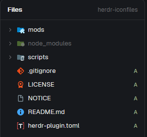

# herdr-iconfiles

VS Code–style file and folder icons for the **Files** panel of the
[Herdr](https://herdr.dev) desktop app, using the
[Material Icon Theme](https://github.com/material-extensions/vscode-material-icon-theme)
(the same set as the popular VS Code / Cursor extension).



- 1,256 icons: 1,400+ extensions, 2,100+ file names (`package.json`, `Dockerfile`, `.gitignore`…),
  4,600+ folder names (`src`, `.github`, `node_modules`, `docs`…), with open-folder variants.
- Compound extensions resolve like VS Code: `x.service.spec.ts` → test icon, `x.controller.ts` → controller icon, `x.ts` → TypeScript.
- Files and folders ignored by `.gitignore` are dimmed (gray text, faded icon), like in VS Code;
  everything inside an ignored folder is dimmed too.
- Light themes use the theme's light variants.
- Everything else (preview, git marks, live refresh) is Herdr's own Files panel.

## Install

```sh
herdr plugin install matridev/herdr-iconfiles
```

That's it. Installing:

1. copies the `file-icons` mod into the Herdr app home (`~/.config/herdr-app`;
   under WSL, the Windows one at `%USERPROFILE%\.config\herdr-app`),
2. adds a `main-file-icons` layout — Herdr's `main` layout with the Files
   panel pointing at `file-icons`,
3. switches the open window to it.

`ctrl-shift-l` cycles layouts if you want to go back to `main`.

Update with `herdr plugin update matridev.iconfiles` (the mod is copied again;
your `main-file-icons` layout is kept).

### Remove

```sh
herdr plugin action invoke matridev.iconfiles.uninstall   # Windows: .uninstall-windows
herdr plugin uninstall matridev.iconfiles
```

### Repair / reinstall the mod

```sh
herdr plugin action invoke matridev.iconfiles.install     # Windows: .install-windows
```

## Why a layout?

Herdr's shipped mods and layouts are read-only (the app restores them on every
start), so the documented way to change one is a copy. The plugin installs its
own mod and a copy of the `main` layout that uses it. If you already use your
own layout, set the Files block's `"content": { "mod": "file-icons" }` there instead.

## Development

```
herdr-plugin.toml          herdr plugin manifest (build step = install)
scripts/install.sh         installer for Linux, macOS and WSL
scripts/install.ps1        installer for Windows
scripts/build-icons.mjs    regenerates icons/ and icon-map.js from material-icon-theme
mods/file-icons/           the Herdr app mod
  main.js                  the Files panel (from Herdr's `files` mod) with icons
  icons.js                 file/folder → icon resolution
  icon-map.js              generated lookup tables
  icons/                   generated SVGs
```

```sh
node scripts/build-icons.mjs [version]   # refresh icons (needs node + npm)
sh scripts/install.sh install            # install from the working tree
herdr-app check ~/.config/herdr-app/mods/file-icons
```

## License

Apache-2.0 (the panel derives from Herdr's `files` mod). Icons: MIT, Material
Icon Theme. See [NOTICE](NOTICE).
